<div align="center">



[](mailto:mahdizolfaghari3181@gmail.com)
[](https://www.linkedin.com/in/mahdi-zolfaghari-0937b3233/)

</div>

```console
mahdi@dev:~$ whoami
Mahdi Zolfaghari, backend developer (Python / Django)

mahdi@dev:~$ cat about.txt
Building web backends since 2021. I work on payments, large file
uploads and third-party integrations, and I try to leave code that
the next person can read.

mahdi@dev:~$ history | grep work
  2024-10 → 2026-02   Backend Developer   Kateb
  2023-06 → 2024-09   Backend Developer   Salon 20 (booking startup)
  2022-11             Backend Mentor      Maktab Sharif

mahdi@dev:~$ cat education.log
  2026        MSc, Computer Engineering   Islamic Azad University of Hamadan
  2020-2024   BSc, Computer Science       Kermanshah University of Technology

mahdi@dev:~$ echo $STATUS
currently working
```

## 🛠️ Stack

<div align="center">


</div>

## 🔎 What I've worked on

- 💳 **Payments and pricing:** payment gateway integrations, discount and promotional pricing, a financial system
- 📁 **File handling:** a unified file system with chunked uploads for large files and hardened upload security
- 🔌 **Integrations:** Moodle and BigBlueButton, plus a product layer that lets any part of a platform be sold on its own
- 🧹 **Legacy code:** refactoring for readability, performance and maintainability
- 🧑‍🏫 **Mentoring:** code review and learning paths for new backend developers

## 📊 GitHub

<div align="center">

[](https://github.com/mahdizo3181?tab=followers)


</div>

## 📫 Contact

Email is the quickest way to reach me: **mahdizolfaghari3181@gmail.com**

